<div align="center">

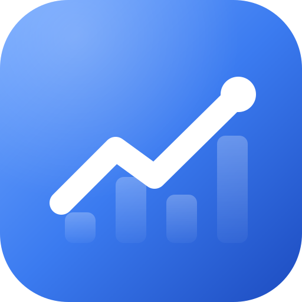

# Free Portfolio Tracker for Meta Muse

**A free stock, ETF and dividend tracker that lives in your own [Meta Muse](https://about.fb.com/news/2026/11/introducing-spaces-customize-muse-app/) space.<br />No subscription, no limits, no coding.**

[](#is-it-really-free)
[](#is-it-really-free)
[](#get-it-in-meta-muse)
[](#your-privacy)
[](LICENSE)

[Set it up](#get-it-in-meta-muse) · [What you get](#what-you-get) · [Compare with other apps](#how-it-compares-with-other-apps) · [Screenshots](#screenshots) · [FAQ](#faq)

<br />

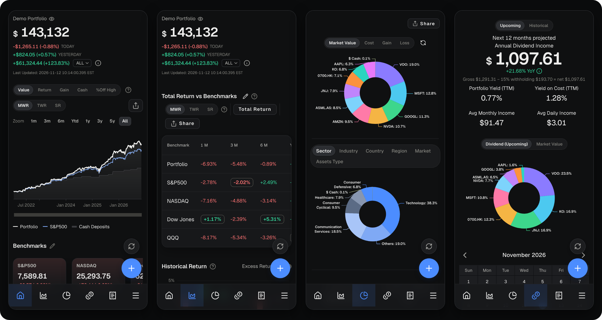

<sub>Screenshots show a made-up example portfolio. Yours starts empty.</sub>

</div>

---

## What is it?

A portfolio tracker puts all your investments in one place. It shows what they're worth today, how much you've made or lost, and which dividends are coming.

This one is free. It runs as a *space* inside the Meta Muse app (a small personal app you make in Muse), so it's on your phone and your computer.

**It's for you if you:**

- own stocks, ETFs, funds or crypto, with one broker or several;
- want to see everything together, with live prices;
- don't want a monthly fee, or a free plan that runs out after 10 holdings;
- would rather keep your trades in your own space than in another company's account.

## What you get

All of it is free. Nothing is locked behind a paid plan.

- **What it's worth today.** Your total value, today's change, and your gain or loss since you started.
- **Are you beating the market?** Compare your returns with the S&P 500 or any other index, over a month, a year or all time.
- **Dividend income.** What you've received, what's coming, a payment calendar and your yield. Set your withholding tax rate and it shows what actually reaches you.
- **Where your money is.** By company, sector, country, region and type, so you can spot when too much sits in one place.
- **How bumpy the ride is.** Your biggest drop from a high, how much your value swings, and more.
- **Goals.** Set a target, like 100,000 by 2035, and see each month whether you're on track.
- **Rebalancing.** Set the mix you want, and it tells you how much of each holding to buy or sell.
- **Every trade.** The gain or loss on each purchase, how often you beat the market, and what you've paid in fees.
- **Many currencies.** Hold shares from different countries. Everything is converted into your home currency (21 to choose from) at each day's exchange rate.
- **Anything else you own.** Property, private funds or anything without a ticker, with prices you enter yourself.
- **Made for your phone.** Simple bottom buttons that slide away while you scroll. It keeps working offline with the last prices it saw. On a computer you get a wider view.
- **Your data, backed up.** Every change saves by itself. Download a backup file whenever you like.

It works with stocks, ETFs, funds, REITs and crypto on most of the world's stock exchanges: the US, Singapore, Hong Kong, London, Europe, Japan, Australia, Canada and more.

## Get it in Meta Muse

Three steps. No coding, nothing to install and no new account.

### Step 1: Paste this into Muse

Copy the whole box below (use the copy button at its top right) and send it to Muse. It tells Muse to copy the finished tracker, so you get exactly the app shown here.

```text
Create a space that runs the ready-made Portfolio Tracker web app from
https://github.com/AxiaMil/portfolio-tracker (MIT licence).

The repository contains the finished space. Build it by copying, not by designing:
- Copy the files listed in muse/manifest.json to the places it gives:
  muse/space.json -> space.json, muse/client/index.html -> client/index.html,
  muse/client/src/main.ts and host.ts -> client/src/,
  muse/server/src/actions.ts, market.ts and schema.ts -> server/src/.
- Copy app/portfolio-tracker.js byte for byte to client/src/portfolio-tracker.js. It is the
  whole app in one prebuilt, tested file and loads nothing else. It never builds code from a
  string (no eval or Function()), so it passes the publishing check as it is: never patch it.
  At start-up it keeps the space's style checker (__tunnel) for page elements only, so its
  chart labels draw correctly. That is intended: leave it.
- Connect only the two lines that depend on this space's starter, and change nothing else:
  client/src/host.ts imports callAction(name, input) from the starter's server-action client,
  and server/src/actions.ts imports db from the starter's Drizzle database.
- Remove the starter's own App component, styles and #root. The page holds only #app.

Do not edit, rebuild, minify, split, unpack, restyle, translate, re-implement or port the app.
Do not add anything to the interface: no header, title bar, avatar, labels under the
navigation icons, banner, tips or notes. Do not add sample data: the app starts empty.

Time: the app shows every time in the user's local time zone, taken from their device. Do not
set, force or convert a time zone anywhere in the space (never force UTC).

Storage: the two tables in server/src/schema.ts. app_state holds the whole portfolio as one
JSON document under the key "portfolio"; market_cache holds the market snapshot.
Server actions: the six in server/src/actions.ts. Scheduled job: refreshMarketCache every
10 minutes, as in space.json. Network access: query1.finance.yahoo.com and
query2.finance.yahoo.com only. No other database, no login, no API keys.

When it is ready, run refreshMarketCache once, then check: Home shows 0.00 with an empty
chart; the + button opens "Manage Transaction"; adding "Buy AAPL, 10 shares" shows a value
within a few seconds; Allocation's donut labels (such as AAPL and its share) are then plain
text, with no box behind them; Home's "Last Updated" line shows the user's local time and time zone
(such as GMT+8 in Singapore); Settings -> Data & Backup says "Muse space storage"; reloading
the space keeps the transaction.
```

### Step 2: Say yes to Yahoo Finance

Muse asks whether the space may connect to two Yahoo Finance addresses. Approve both. That's where prices, dividends and exchange rates come from. Only ticker symbols such as `AAPL` are sent, never your amounts.

### Step 3: Add your investments

Tap **+** to add a buy or a sell, or upload a file of your trades (see [Adding your trades](#adding-your-trades)). Your space starts with one empty portfolio called *My Portfolio*.

<details>
<summary><b>Muse changed how it looks?</b></summary>

Send Muse this:

```text
Undo every change you made to the tracker. Rebuild the space from the muse/ folder of
https://github.com/AxiaMil/portfolio-tracker exactly as muse/manifest.json lists it, with
app/portfolio-tracker.js copied byte for byte. No extra header, title, avatar, navigation
labels, banners or notes.
```

</details>

<details>
<summary><b>Made your space with an earlier version?</b></summary>

Send Muse this to update it. Your portfolio is kept:

```text
Update this space to the current Portfolio Tracker space in the muse/ folder of
https://github.com/AxiaMil/portfolio-tracker (latest main), exactly as muse/manifest.json
lists it, with app/portfolio-tracker.js copied byte for byte to client/src/.
- Keep the app_state and market_cache tables and all their rows as they are: they already
  match server/src/schema.ts. Do not reset or migrate the saved portfolio.
- Replace the old front end (the embedded app/ files, blob URLs, import map, boot ladder and
  fetch cache) with client/index.html, client/src/main.ts and client/src/host.ts. The app now
  does the caching, request limits, retries and snapshot loading itself.
- Replace the server actions with server/src/actions.ts and market.ts. Keep the 10-minute
  refreshMarketCache job.
- Times show in the user's local time zone, from their device. Do not set or force a time zone.
- The current app file builds no code from strings (no eval or Function()), so it passes the
  publishing check as it is. Never patch it.
- At start-up the app keeps the space's style checker (__tunnel) for page elements only, so
  its chart labels draw correctly. That is intended: leave it.
Do not change the app or add anything around it.
```

</details>

## How it compares with other apps

There are plenty of good portfolio trackers. This is an honest comparison with popular ones, so you can pick the one that suits you.

### The short answer

**Choose this tracker if** you use Meta Muse, you're fine adding trades yourself or uploading a file, and you want every feature free with no limits.

**Choose another app if** you want your broker to send trades in automatically, you need tax reports, or you don't use Meta Muse.

### Free plans and prices

| App | What you get free | Paid plans |
|---|---|---|
| **This tracker** | Everything, with no limit on portfolios, holdings or trades | None |
| [Sharesight](https://www.sharesight.com/pricing/) | 1 portfolio and 10 holdings, counting ones you've sold | From US$7 a month, paid yearly |
| [Portseido](https://www.portseido.com/pricing/) | 1 portfolio and 100 transactions in total | From US$8 a month, paid yearly |
| [Delta](https://delta.app/en/pro) | 10 assets | From US$6.99 a month, or US$53.88 a year |
| [Stock Events](https://stockevents.app/en/pricing) | 15 stocks | US$49.99 a year, plus US$0.99 a week for broker sync |
| [getquin](https://www.getquin.com/pricing/) | Bank and broker connections, and basic analysis | From €89.99 a year |
| [Ghostfolio](https://github.com/ghostfolio/ghostfolio) | Free and open source, if you run it on your own server | A paid plan for the hosted version |
| A spreadsheet | Whatever you build yourself | None |

<sub>Prices and limits come from each app's own pricing page on 12 November 2026. They change, so check before you decide.</sub>

### Pros and cons

| App | Good at | Not so good at |
|---|---|---|
| **This tracker** | Free with no limits. Every chart and report included. No new account. Your data stays in your own space. Open source | Needs Meta Muse. No automatic broker sync. No tax reports, price alerts or news. Prices come from Yahoo Finance's free feed |
| **Sharesight** | Tax and sold-shares reports. Automatic dividends. Reads trades from your broker's confirmation emails | The free plan fills up at 10 holdings, including sold ones. Deeper reports need the higher plans |
| **Portseido** | Syncs trades from your broker, even on the free plan. Phone apps | The free plan stops at 100 transactions. Separate portfolios need the Pro plan |
| **Delta** | Phone app that also links crypto wallets and exchanges | 10 assets free. Unlimited assets need PRO+ |
| **Stock Events** | Dividend and earnings calendar. Simple phone app | 15 stocks free. Portfolio analysis and custom assets need Pro. Broker sync costs extra |
| **getquin** | Links your bank and broker accounts. Net worth overview | Dividend forecasts and deeper analysis need Premium |
| **Ghostfolio** | Open source. Private when you run it yourself | Running it yourself needs a server and technical skills |
| **A spreadsheet** | Total control, and free | You build and fix everything. Returns, dividends and currencies are hard to get right |

### Things to know before you start

This tracker isn't perfect for everyone. The downsides:

- **You need Meta Muse.** It's built to run as a Muse space. It can run elsewhere, but that takes technical setup.
- **Your broker doesn't send trades in by itself.** You add them by hand or upload a file from your broker.
- **Prices come from Yahoo Finance's free feed.** It can be delayed, depending on the exchange, and is sometimes unavailable. When that happens, the app shows the last prices it had.
- **No tax reports, price alerts or news.** It shows the gain on every trade and exports everything to a spreadsheet, but it doesn't make tax forms or send alerts.
- **Upcoming dividends are estimates**, based on what each holding paid over the last 12 months.
- **No support team.** It's a free open-source project. You can report problems on [GitHub](https://github.com/AxiaMil/portfolio-tracker/issues).

## Screenshots

<p align="center">
  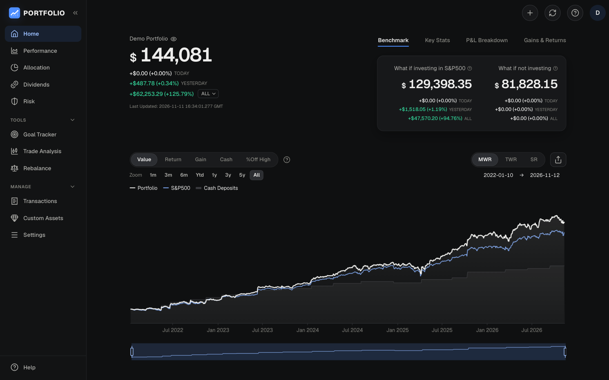
  <br /><b>Home, on a computer</b>
</p>

<table>
  <tr>
    <td width="50%">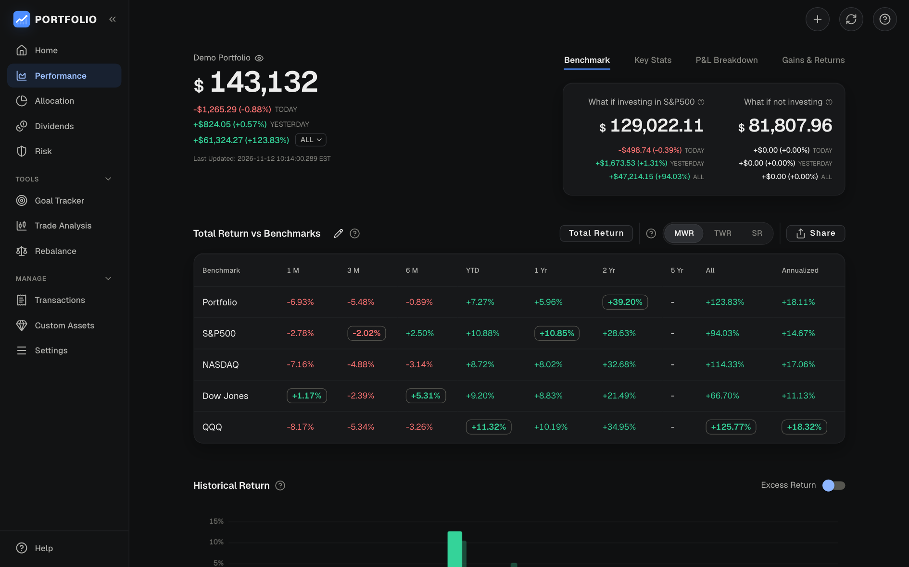<p align="center"><b>Performance</b><br /><sub>Your returns against the market</sub></p></td>
    <td width="50%">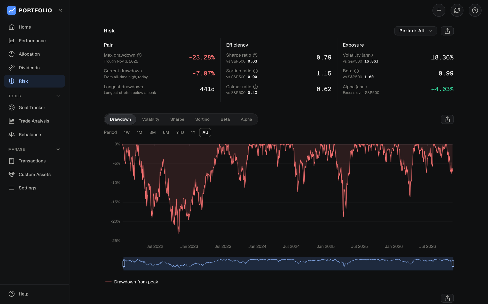<p align="center"><b>Risk</b><br /><sub>How bumpy the ride has been</sub></p></td>
  </tr>
  <tr>
    <td width="50%">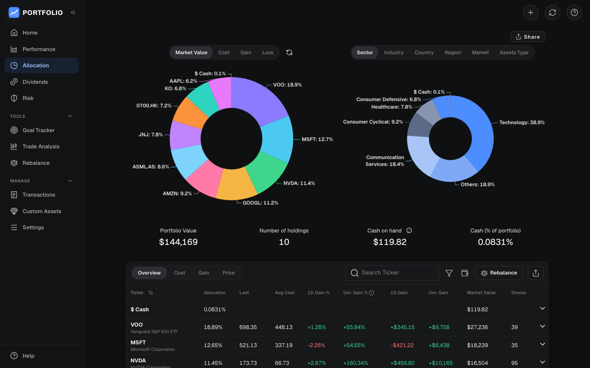<p align="center"><b>Allocation</b><br /><sub>Where your money is</sub></p></td>
    <td width="50%">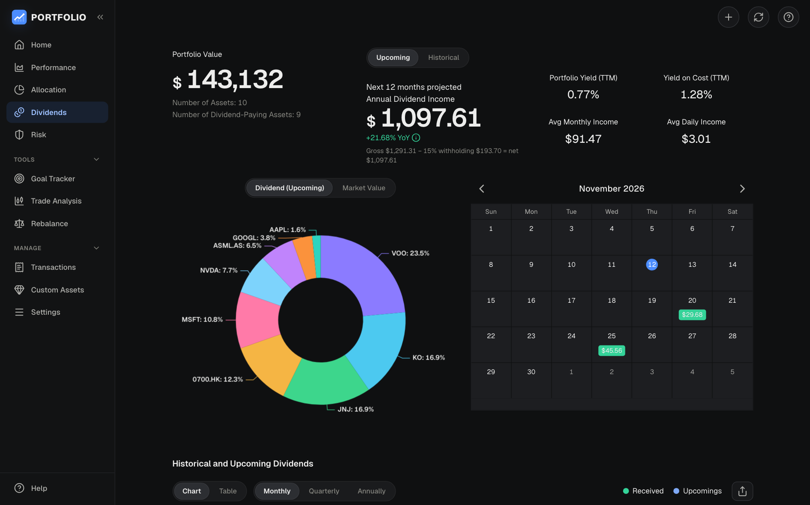<p align="center"><b>Dividends</b><br /><sub>Income received and coming up</sub></p></td>
  </tr>
  <tr>
    <td width="50%">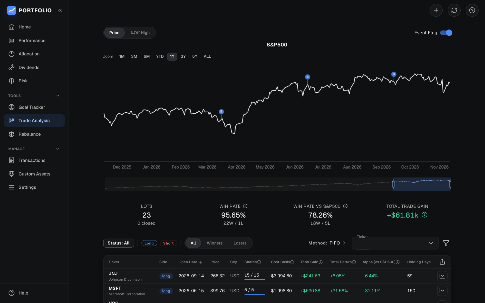<p align="center"><b>Trade analysis</b><br /><sub>How each purchase did</sub></p></td>
    <td width="50%">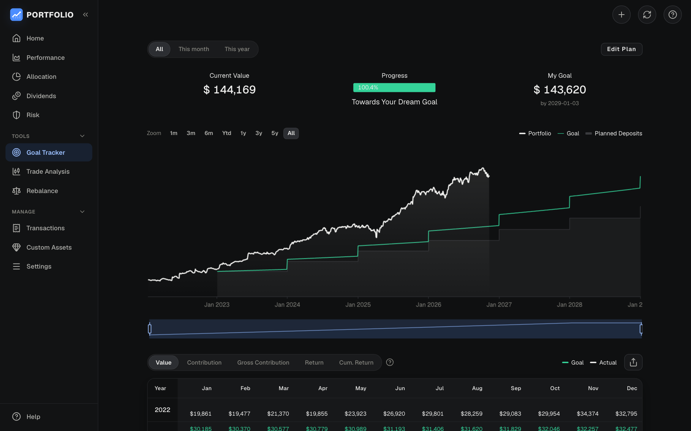<p align="center"><b>Goal tracker</b><br /><sub>Are you on track?</sub></p></td>
  </tr>
</table>

**Three colour themes.** Pick one in **Settings → Appearance**, and change the accent colour if you like.

<table>
  <tr>
    <td width="33%">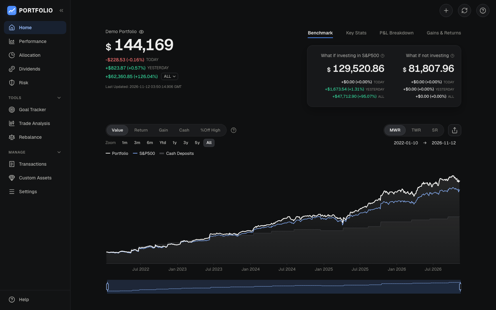<p align="center"><b>Graphite</b> (default)</p></td>
    <td width="33%">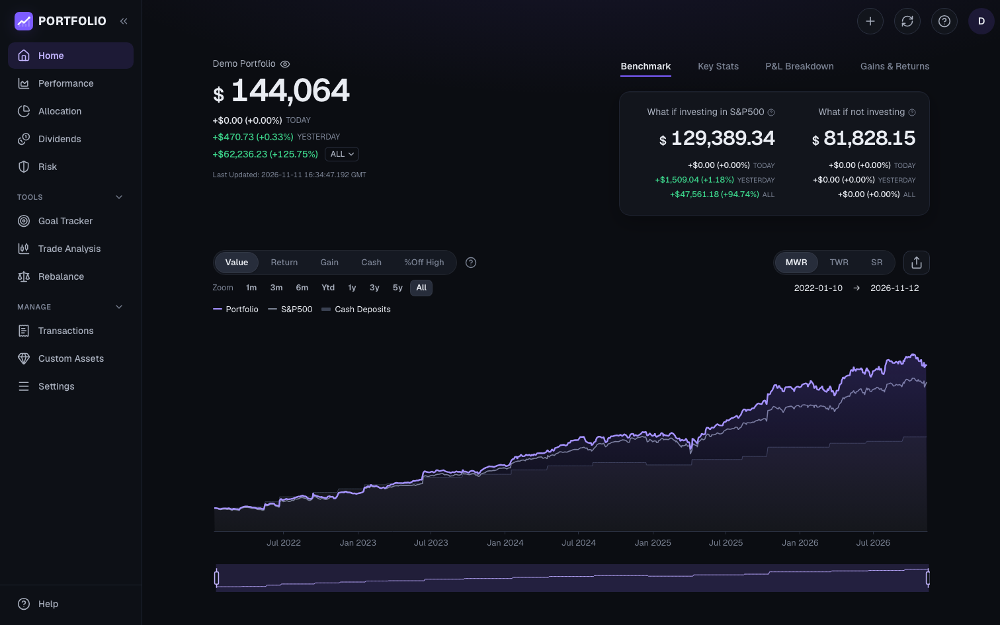<p align="center"><b>Midnight</b></p></td>
    <td width="33%">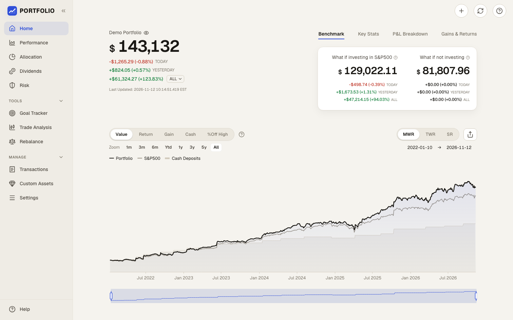<p align="center"><b>Paper</b> (light)</p></td>
  </tr>
</table>

## Adding your trades

**One at a time.** Tap **+**, then fill in the date, buy or sell, the ticker, the number of shares and the price. The app suggests the day's price for you.

**Many at once.** Most brokers let you download your trade history as a CSV file (a simple spreadsheet). Upload it from **Transactions → Upload Files**. It should look roughly like this:

```csv
Date,Action,Ticker,Shares,Price,Currency
2024-03-15,Buy,AAPL,10,172.62,Market
2025-01-10,Sell,AAPL,5,236.85,Market
```

- Column names don't have to match exactly: `Symbol`, `Qty` or `Trade Date` work too. You may need to tidy your broker's file so it has these columns.
- Tickers are the ones Yahoo Finance uses: `AAPL` in the US, `BN4.SI` in Singapore, `0700.HK` in Hong Kong, `VUSA.L` in London.
- `Market` means the currency the share trades in.

The full list of columns and actions is in [Technical details](docs/TECHNICAL.md#importing-trades-the-full-csv-format).

**Moving from another copy of this tracker?** There, use **Settings → Data & Backup → Download backup**. Then use **Restore from file** in your space.

## Your privacy

- Your trades, portfolios and goals are saved in your own Muse space, and nowhere else.
- To get prices, your space sends ticker symbols (like `AAPL`) to Yahoo Finance. Your amounts, name and accounts are never sent.
- There are no ads and no sign-up.
- Your device keeps recent copies of your data and prices, so the app opens fast and works offline. You can restore those copies in **Settings → Data & Backup**.
- Download a backup file whenever you want a copy of your own.

## FAQ

### Is it really free?

Yes. It's open source under the MIT licence. There's no subscription, paid plan, ads or usage limit, and it never asks for payment. All you need is the Meta Muse app to run it in.

### Do I need to know how to code?

No. Paste the prompt from [Step 1](#step-1-paste-this-into-muse), and approve Yahoo Finance when Muse asks. Muse copies the finished app.

### Can it connect to my broker?

Not directly. Download your trade history from your broker as a CSV file and upload it, or add trades by hand. See [Adding your trades](#adding-your-trades).

### What can I track?

Any stock, ETF, fund, REIT, index or cryptocurrency that Yahoo Finance lists, such as `AAPL` or `BTC-USD`. For anything else, like property or a private fund, add a **Custom Asset** and enter its prices yourself.

### Is my data the same on my phone and my computer?

Yes. It's saved in your space, so every device that opens the space sees the same portfolio.

### Prices look out of date, or the refresh button is amber.

Prices update every minute while the app is open, and your space refreshes them every 10 minutes while it's closed. Tap the refresh button to update now. It turns amber when Yahoo Finance can't be reached, and the app shows the last prices it had.

### The very first time, it waited for prices.

A brand-new space has no prices saved yet, so the first open downloads them and shows a count. After that it opens straight away.

### It says "Your portfolio couldn't be loaded".

Tap **Try again**. Your portfolio is safe: the app never saves over it when it can't read it. On a phone, Muse sometimes needs a few seconds to connect when you first open the space. The tracker already tries again several times on its own, so this screen is rare.

### Chart labels show as solid boxes, or a chart is missing.

Your space has a copy from before 13 November 2026. Update it with the prompt in [Made your space with an earlier version?](#step-3-add-your-investments). Your portfolio is kept.

### A ticker can't be found.

Search uses Yahoo Finance's ticker symbols, which add a suffix for many exchanges (`.SI` for Singapore, `.HK` for Hong Kong, `.L` for London). If Yahoo doesn't list it, add it as a **Custom Asset**.

### Why are my dividends lower than what my shares pay?

If you've set a dividend tax rate (*Settings → Portfolio Settings*), the Dividends page shows what you get after tax. The top line shows the amount before tax, the tax, and what's left.

### Is this financial advice?

No. It's a record-keeping and analysis tool. Check important numbers against your broker's statements.

### Can I use it without Meta Muse?

Yes, but it takes technical setup, and each browser keeps its own copy of your data. See [Technical details](docs/TECHNICAL.md#development).

## For developers

Want to see how it works, how each number is calculated, or change it? See **[Technical details](docs/TECHNICAL.md)** and **[Hosting](docs/HOSTING.md)**. It's built with Vue 3, Vuetify and Apache ECharts, and the Muse space is in [`muse/`](muse).

## Disclaimer

Market data comes from Yahoo Finance's public, unofficial endpoints. It is meant for personal use and may be delayed or wrong. This project isn't affiliated with Meta, Yahoo, any broker or any of the apps compared above. Their names are trademarks of their owners.

## License

[MIT](LICENSE)
